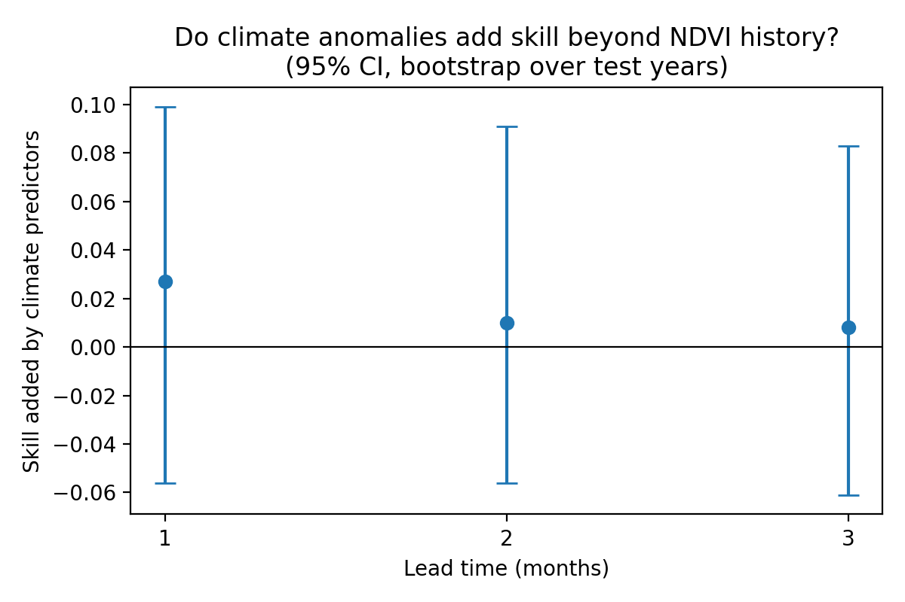
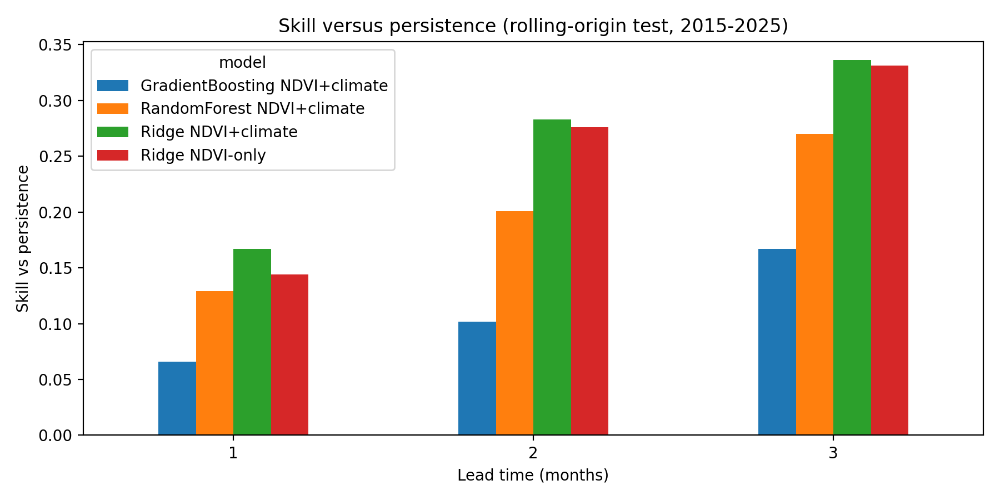

# Do Climate Anomalies Improve Short-Term Vegetation Forecasts Beyond Persistence? Pothohar Region, Pakistan

Google Earth Engine + scikit-learn. Districts: Chakwal, Rawalpindi, Jhelum, Attock. Monthly data 2001-2025.

## Question
Do rainfall, soil-moisture and temperature anomalies improve forecasts of NDVI anomalies 1-3 months ahead, beyond a model that uses vegetation history alone?

## Design history (stated openly)
- v1: raw VCI, one 2019-2025 test block: almost no skill (R2 about 0.03-0.06).
- v2: anomalies against a fixed 2001-2017 baseline: test years looked "above normal" because NDVI drifts upward over time, which made skill versus climatology misleading.
- v3 (this notebook): trailing 10-year baseline and rolling-origin evaluation (test years 2015-2025, each predicted from earlier data only). v3 was designed after seeing v1 and v2, so it is not a blind test. Settings were fixed in advance and each result was computed once.

## Methods
Data from Earth Engine (MODIS NDVI, CHIRPS rainfall, ERA5-Land temperature and soil moisture; district means). Ridge, Random Forest and Gradient Boosting were compared with persistence and climatology baselines. The primary comparison is Ridge with climate predictors versus Ridge with NDVI history only; 95% confidence intervals use a bootstrap over test years.

## Results

### Primary comparison (skill; 95% CI from a bootstrap over test years)
| Lead (months) | Comparison | Skill | 95% CI | Test years better |
|---|---|---|---|---|
| 1 | Climate adds to NDVI history (Ridge) | 0.027 | -0.056 to 0.099 | 6 of 11 |
| 1 | NDVI-history model vs persistence | 0.144 | 0.066 to 0.197 | 8 of 11 |
| 1 | Ridge with climate vs persistence | 0.167 | 0.040 to 0.269 | 8 of 11 |
| 2 | Climate adds to NDVI history (Ridge) | 0.010 | -0.056 to 0.091 | 5 of 11 |
| 2 | NDVI-history model vs persistence | 0.276 | 0.150 to 0.360 | 9 of 11 |
| 2 | Ridge with climate vs persistence | 0.283 | 0.155 to 0.376 | 8 of 11 |
| 3 | Climate adds to NDVI history (Ridge) | 0.008 | -0.061 to 0.083 | 5 of 11 |
| 3 | NDVI-history model vs persistence | 0.331 | 0.158 to 0.452 | 9 of 11 |
| 3 | Ridge with climate vs persistence | 0.336 | 0.192 to 0.445 | 9 of 11 |

### Skill versus persistence, all models
| Model | 1 month | 2 months | 3 months |
|---|---|---|---|
| Persistence | 0.000 | 0.000 | 0.000 |
| Climatology (zero anomaly) | -0.690 | -0.023 | 0.155 |
| Ridge, NDVI only | 0.144 | 0.276 | 0.331 |
| Ridge, NDVI + climate | 0.167 | 0.283 | 0.336 |
| Random Forest, NDVI + climate | 0.129 | 0.201 | 0.270 |
| Gradient Boosting, NDVI + climate | 0.066 | 0.102 | 0.167 |

### Findings
- A Ridge model using NDVI history beat persistence at all lead times, and the confidence intervals are above zero.
- Adding climate predictors gave no reliable gain: all three intervals include zero.
- Random Forest and Gradient Boosting did not outperform Ridge.
- Persistence is a weak baseline at longer leads (a zero-anomaly forecast beat it by 0.155 at 3 months), so skill versus persistence overstates the gain there.
- The trailing baseline reduced, but did not remove, the positive NDVI drift (yearly mean anomalies remain mostly positive).

### Exploratory only (four comparisons, no confidence intervals): lead 1, by target season
| Season | Test months | Skill added by climate predictors |
|---|---|---|
| Winter (Dec-Feb) | 128 | 0.171 |
| Spring (Mar-May) | 132 | 0.248 |
| Monsoon (Jun-Sep) | 176 | -0.065 |
| Autumn (Oct-Nov) | 88 | -0.203 |

This is a hypothesis (climate information may matter for the winter crop cycle), not a finding.

## Limitations
District means hide spatial variation; 1 km MODIS; no cropland mask; four districts; 11 test years; the cause of the NDVI drift was not investigated; v3 design chosen after seeing earlier results.

## Future work
Cropland-masked pixel-level modelling, seasonal models for the winter crop cycle, explanations for the NDVI drift, and additional predictors such as irrigation data.

## Files
- `Project1_v3_Rolling_Origin_Forecasting.ipynb`: full analysis (open in Google Colab)
- `monthly_district_data.csv`: monthly district data from Earth Engine
- `metrics_v3.csv`, `primary_comparison_v3.csv`, `seasonal_exploratory_v3.csv`: result tables
- `climate_added_skill_v3.png`, `skill_vs_persistence_v3.png`: figures

## How to run
Open the notebook in Google Colab, choose Runtime, then Run all, and upload `monthly_district_data.csv` when asked.
